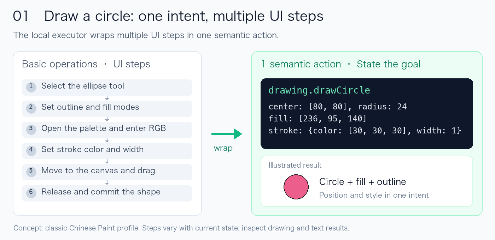
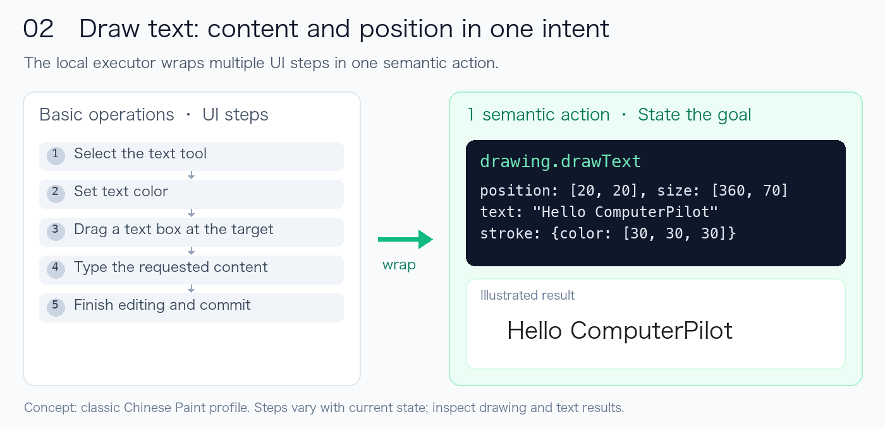
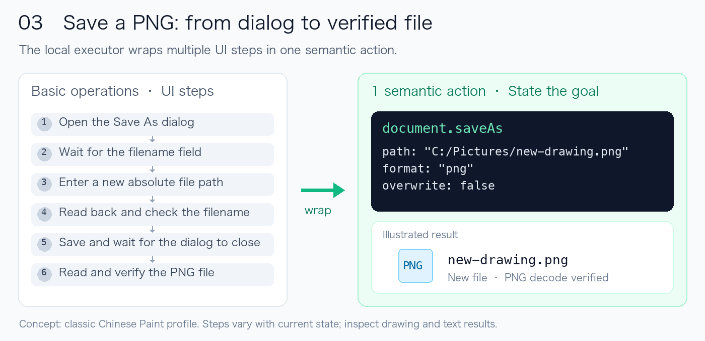

<p align="center">
  
</p>

<p align="center"><strong>Semantic actions. Replayable workflows.</strong><br>Native computer use for AI agents, with fewer model round trips.</p>

<p align="center">
  <a href="https://github.com/ClarkWain/ComputerPilot/actions/workflows/build.yml"></a>
  <a href="LICENSE"></a>
  <a href="README.zh-CN.md">简体中文</a>
</p>

ComputerPilot is a native execution engine for AI agents on **Windows and macOS**. Give it an application-level action or a batch of concrete inputs; the local executor handles targeting, tool changes, styling and continuous input. Inspect the result, then turn a successful process into a reusable Replay recipe.

[Get started](#get-started) · [Downloads](https://github.com/ClarkWain/ComputerPilot/releases) · [Semantic actions](docs/SEMANTIC-PROFILES.md) · [Replay](docs/REPLAY.md) · [Roadmap](docs/ROADMAP.md)

## Watch a blank canvas bloom

This is a **real Replay running in macOS Preview**: the executor locates the controls, changes colors and draws a flower with 12 actual pointer strokes.


**4× playback**, with a two-second final hold. The animation comes from an actual window recording. [Original-speed video](docs/media/flower-replay.mp4) · [Runnable recipe](examples/replays/flower-preview/replay.json) · [Recording details](examples/readme-media/README.md)

The recording was made before the rename, so its title bar still says DesktopPilot. The saved PNG matched the reference RGB pixels exactly; the compressed video is illustrative evidence of the process.

## One semantic action, many basic operations

A matched application profile turns an intent into concrete local interactions. The agent supplies geometry, text or a destination; the executor handles the supported UI sequence.







These diagrams illustrate the **implemented classic Chinese Paint profile**. The exact internal steps depend on the current state. Semantic execution reduces the agent's repeated targeting and planning; the required underlying UI interactions still happen locally. Inspect the final drawing or business result.

Multiple intents can share one `execute_semantic` call and reuse confirmed settings:

```json
{
  "window_id": "ID returned by list_windows",
  "actions": [
    {"action": "drawing.drawCircle", "args": {"center": [80, 80], "radius": 24, "fill": [236, 95, 140], "stroke": {"color": [30, 30, 30], "width": 1}}},
    {"action": "drawing.drawCircle", "args": {"center": [150, 80], "radius": 24}}
  ]
}
```

Profiles are matched against the actual executable, layout, DPI and UI evidence. Without a suitable profile, use `execute_batch` for controls, text, keys, dragging and continuous pointer paths. [Profile reference](docs/SEMANTIC-PROFILES.md)

## Run once, keep the workflow

- **Record explicitly.** `serve --record NEW_DIRECTORY` records ComputerPilot calls.
- **Export offline.** `recording-export` derives a reviewable recipe from the journal and rebuilds selectors and canvas-relative strokes.
- **Locate again.** Replay observes the current application and maps strokes to its current canvas origin.
- **Resume deliberately.** At supported stroke boundaries, save a checkpoint and verify the original document, file, tools and canvas before continuing unfinished steps.

```sh
# Validate a recipe without desktop input.
./build/core/computer-pilot replay --file examples/replays/flower-preview/replay.json

# Run in a new document; the output directory must not already exist.
./build/core/computer-pilot replay \
  --file examples/replays/flower-preview/replay.json \
  --mode run --output out/my-flower

# Or pause after the stem and leaves, then continue explicitly.
./build/core/computer-pilot replay \
  --file examples/replays/flower-preview/replay.json \
  --mode run --output out/split-flower --stop-after 14
./build/core/computer-pilot replay-resume --from out/split-flower
```

Replay execution, drawing export and checkpoint resume currently target **macOS PNG drawing**. Windows can validate recipes. Recording captures ComputerPilot calls, rather than global manual input. Unknown input outcomes stop execution for inspection. [Replay](docs/REPLAY.md) · [Recording](docs/RECORDING.md)

## Why this execution layer

| Value | Mechanism |
|---|---|
| Less repeated context | Read structured controls first; request images and crops as needed |
| Fewer model round trips | Submit supported semantic actions and stable input groups in a batch |
| Faster repeated work | Execute locally and reuse confirmed targeting and settings within a batch |
| Reusable processes | Keep a validated process as a recipe instead of planning every step again |
| Inspectable progress | Retain reports, evidence and supported checkpoints |

Recorded examples include a 64.5% reduction in screenshot transfer bytes in one PNG/WebP comparison, exact-RGB flower replay, and a 14 → 20 → 27-step checkpoint run without redrawing the completed prefix. These are task-specific measurements, not universal token-cost or speedup claims. [Screenshot evidence](docs/OPTIMIZATION-VALIDATION.md) · [Replay evidence](examples/replays/flower-preview/README.md)

## Get started

Download a **Core** archive from [Releases](https://github.com/ClarkWain/ComputerPilot/releases), verify `SHA256SUMS.txt`, extract it, and point your MCP client at its executable:

```json
{
  "mcpServers": {
    "computer-pilot": {
      "command": "/absolute/path/ComputerPilot/bin/computer-pilot",
      "args": ["serve"]
    }
  }
}
```

On Windows, use `C:/tools/ComputerPilot/bin/computer-pilot.exe` and install Microsoft Visual C++ 2015–2022 x64 Runtime. On macOS, grant Accessibility and Screen Recording permission to the actual executable or its launching host. The initial macOS release targets **Apple Silicon** and is **unsigned and not notarized**; see the [installation guide](docs/INSTALLATION.md) before running a downloaded archive.

Core runs without Node, Python or model weights. Source builds require CMake 3.29+, Visual Studio 2022 on Windows, or Xcode Command Line Tools on macOS 14+. Build/test tooling additionally uses Python 3 and PowerShell:

```sh
git clone https://github.com/ClarkWain/ComputerPilot.git
cd ComputerPilot
cmake --preset core-only
cmake --build --preset core-only --parallel 4
ctest --preset core-only -LE interactive
```

[MCP setup](docs/MCP.md) · [Installation](docs/INSTALLATION.md) · [macOS permissions](docs/MACOS.md) · [Build guide](docs/BUILDING.md)

## Four tools

| MCP tool | Purpose |
|---|---|
| `list_windows` | Discover the actual target window |
| `get_window_state` | Read controls, screenshots and matching profiles |
| `execute_semantic` | Execute supported application-level intents |
| `execute_batch` | Batch concrete keyboard, pointer and text operations |

Replay and recording have CLI entry points. The public MCP surface remains these four tools. [API](docs/AGENT-API.md) · [Agent skill](skills/computerpilot/SKILL.md)

## Current coverage

| Capability | Scope |
|---|---|
| Native desktop backend | Windows x64 and macOS 14+; initial macOS binaries: arm64 |
| Paint semantics | Classic Chinese Paint; restricted modern Chinese Paint 11.2605.81.0 at 120 DPI and 100% canvas zoom |
| Aseprite semantics | Windows v1.2.15 English at 120 DPI: tool/zoom hotkeys and clicks; OCR menu actions require an optional OCR build |
| macOS application profiles | General controls and basic input; no added Paint/Aseprite profile |
| Replay execution and resume | macOS PNG drawing; Windows recipe validation |
| General orchestration | Historical `refactor/node-orchestration` branch, experimental Windows host; not integrated into this native release |

Aseprite has no pixel-drawing or save semantics in this release. Application input requires an unlocked interactive session; `ready:false` is a diagnostic stop. Partial or uncertain input is never automatically replayed. [Security and data handling](SECURITY.md)

The [orchestration research branch](https://github.com/ClarkWain/ComputerPilot/tree/refactor/node-orchestration) is preserved with its original DesktopPilot naming and history. Its dedicated Aseprite CLI file workflow has recorded validation; general GUI orchestration remains under development. [Roadmap](docs/ROADMAP.md)

## Contribute

See [CONTRIBUTING.md](CONTRIBUTING.md), [open an issue](https://github.com/ClarkWain/ComputerPilot/issues/new/choose), or read the [release notes](CHANGELOG.md). ComputerPilot continues DesktopPilot with its cleaned Git history, branches and version tags preserved. [Migration notes](docs/MIGRATION.md)

Original code is [MIT licensed](LICENSE). Adapted code, third-party components and optional models retain their respective terms in [THIRD_PARTY_NOTICES.md](THIRD_PARTY_NOTICES.md).
