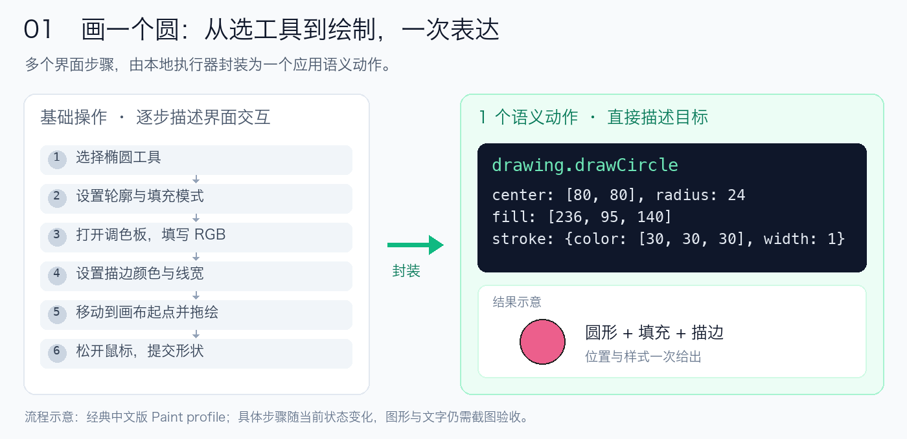
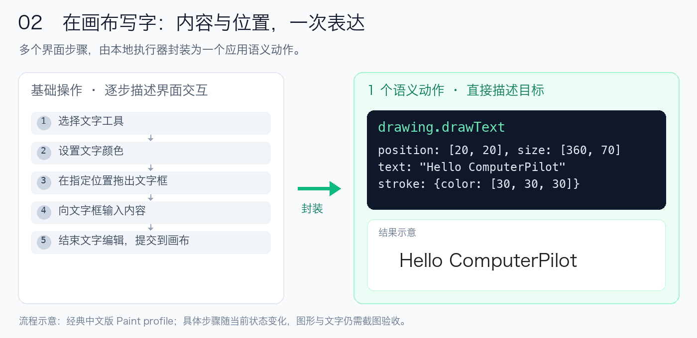
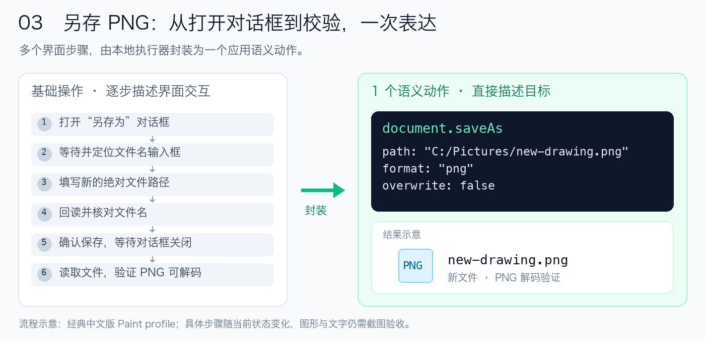
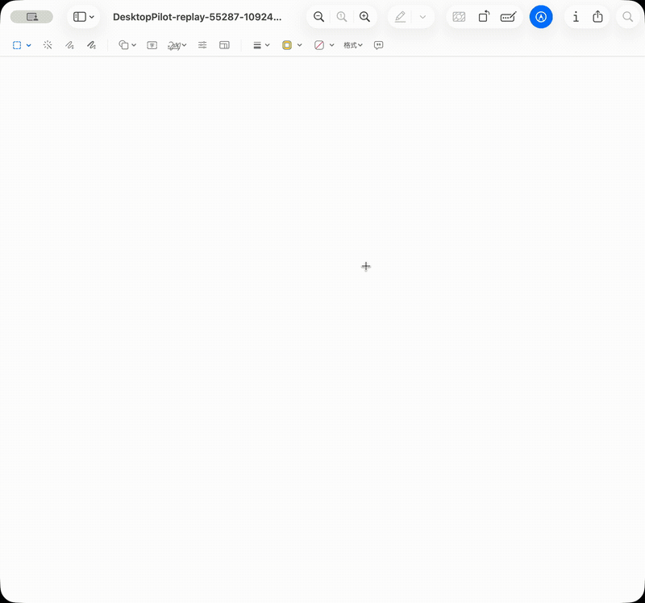

# ComputerPilot

[English](README.md) · 简体中文


## 用语义表达意图，让成功操作反复复用。

**更省上下文，更少交互往返，更快完成重复任务。**

ComputerPilot 是面向 AI Agent 的桌面执行层。它把窗口观察、语义操作、批量执行与 Replay 连接起来，让 Agent 用结构化动作表达意图，由本地执行器完成控件定位、工具切换、样式设置和连续输入，再将成功流程沉淀成可复用的任务配方。

原生核心支持 **Windows / macOS**，通过 **MCP** 接入 Agent；通用任务编排在独立开发分支中持续演进。

[](https://github.com/ClarkWain/ComputerPilot/actions/workflows/build.yml)
[](LICENSE)

[快速接入](docs/MCP.md) · [语义动作](docs/SEMANTIC-PROFILES.md) · [Replay](docs/REPLAY.md) · [编排预览](https://github.com/ClarkWain/ComputerPilot/tree/refactor/node-orchestration) · [发行版本](https://github.com/ClarkWain/ComputerPilot/releases)

## 为什么用 ComputerPilot

Computer Use 的一部分开销，来自模型反复观察界面、决定下一次点击，再等待下一轮反馈。ComputerPilot 将适合本地确定执行的操作组织成更大的执行单元，把模型参与集中在任务规划、关键判断与结果验收上。

适合桌面表单录入、重复编辑、适配应用的绘图，以及由 Agent 驱动的多步骤桌面任务，尤其适合界面稳定、操作重复、结果可以检查的场景。

| 你关心的价值 | ComputerPilot 如何实现 |
|---|---|
| **更省** | 优先读取结构化控件，按需获取截图与局部细节；通过语义动作和批次减少重复上下文与模型往返 |
| **更快** | 在本地连续执行选工具、设置样式和绘制等动作；同批次复用已确认的定位与设置 |
| **更容易复用** | 将实际执行的流程录制、导出为 Replay 配方，适配条件一致时重复运行，减少重新规划 |
| **更容易交付** | 保留执行进度、证据与检查点，在核对原文档和现场状态后继续剩余步骤 |


## 语义执行：用动作表达意图

**一个高级语义动作，封装多个基础操作。** Agent 给出目标、位置与样式，本地执行器负责选工具、处理弹窗、设置参数与连续输入。

### 画一个圆，省去逐步选工具、调颜色和拖绘



### 写一段文字，直接给内容与位置



### 另存 PNG，把对话框操作与文件校验一起交给执行器



以上是**已实现的经典中文版 Paint profile 的流程示意**，具体内部步骤随当前状态变化。一次语义动作仍会执行必要的底层交互；节省的是 Agent 逐步描述、反复定位和等待模型判断的开销。绘图与文字完成后仍需截图验收。

还可以把多个语义动作放进一次 `execute_semantic` 调用。例如，在已匹配该 profile 的窗口中一次提交两个圆：

```json
{
  "window_id": "list_windows 返回的窗口 ID",
  "actions": [
    {
      "action": "drawing.drawCircle",
      "args": {
        "center": [80, 80],
        "radius": 24,
        "fill": [236, 95, 140],
        "stroke": {"color": [30, 30, 30], "width": 1}
      }
    },
    {
      "action": "drawing.drawCircle",
      "args": {"center": [150, 80], "radius": 24}
    }
  ]
}
```

执行器完成选工具、设色、设置线宽与绘制；第二个圆沿用当前样式。同一批次中可以复用已确认的控件与设置，减少重复查询和切换。

profile 根据实际应用、版本、DPI、布局和控件证据匹配。没有适用 profile 时，Agent 仍可通过 `execute_batch` 使用控件点击、文本输入、按键、拖动和连续鼠标路径。

[查看语义动作与适配机制 →](docs/SEMANTIC-PROFILES.md)

## Replay 与录制：把成功流程留下来

将一次验证过的执行变成配方，后续运行由本地执行器重新观察、定位并执行，减少模型逐步重新规划的需求。

- **显式录制**：通过 `serve --record 新目录`，记录 ComputerPilot 实际执行的工具调用。
- **离线导出**：从调用日志生成可检查的 Replay 配方，重新构建定位条件与笔画，移除旧会话引用。
- **重新定位**：执行时获取新控件状态，以当前画布原点映射笔画，处理截图与 Retina 坐标转换。
- **分段执行**：在完整笔画组后保存检查点，核对文件、工具状态和画布像素后，只继续剩余步骤。

### 一个可运行的小花示例

**运行一份配方，看空白画布自己开花。**

下面是在 macOS 中文“预览”中**实际执行 Replay 的窗口录屏**：本地执行器重新定位工具、切换颜色，用 12 条真实画笔路径画出八瓣小花。



录屏制作于改名前，窗口标题仍显示 DesktopPilot。GIF 为 **4 倍速**循环播放，末帧停留 2 秒；由真实窗口视频转换，未用参考图片合成绘制过程。[观看原速视频](docs/media/flower-replay.mp4) · [查看最终参考图](examples/replays/flower-preview/reference.png) · [素材制作说明](examples/readme-media/README.md)

```sh
# 校验配方，不操作桌面
./build/core/computer-pilot replay \
  --file examples/replays/flower-preview/replay.json

# 新建画布并执行；输出目录须不存在
./build/core/computer-pilot replay \
  --file examples/replays/flower-preview/replay.json \
  --mode run --output out/my-flower-replay
```

也可以先画花茎和叶子，稍后继续花瓣与花心：

```sh
./build/core/computer-pilot replay \
  --file examples/replays/flower-preview/replay.json \
  --mode run --output out/split-flower --stop-after 14
./build/core/computer-pilot replay-resume --from out/split-flower --stop-after 20
./build/core/computer-pilot replay-resume --from out/split-flower
```

当前原生 Replay 执行、录制导出与检查点续跑，以 **macOS PNG 绘图**为首个落地场景。录制对象是 ComputerPilot 调用；暂停后需保留原文档与工具现场，输入结果未知时停止并等待核对。

[小花示例](examples/replays/flower-preview/README.md) · [录制与导出](docs/RECORDING.md) · [Replay 与检查点](docs/REPLAY.md)

## 任务编排：从一段操作走向一批任务

主分支已经可以通过语义批次和 Replay 的等待、断言、状态设置与绘制步骤，组织固定的桌面执行流程。

在此基础上，**保留历史和原 DesktopPilot 命名的 `refactor/node-orchestration` 开发分支**提供更高层的编排预览：

- 用可信 JavaScript 的条件、循环和函数组织多步骤任务。
- 在多个窗口间组合观察、语义动作与基础输入，检查执行前后的条件。
- 按项目记录状态、结果和业务检查点，支持人工选择、暂停与取消。
- 恢复时复用已提交结果，遇到未决写入先核对，减少重复执行。

其中，专用文件 Workflow 已完成 Aseprite CLI 单帧素材批量导出的实测；通用跨应用 GUI 编排仍处于开发验证阶段。**这套 Node 编排入口尚未合并到当前原生主分支。**

[通用编排指南](https://github.com/ClarkWain/ComputerPilot/blob/refactor/node-orchestration/docs/guides/ORCHESTRATION.md) · [文件批处理 Workflow](https://github.com/ClarkWain/ComputerPilot/blob/refactor/node-orchestration/docs/guides/WORKFLOW.md) · [验收记录](https://github.com/ClarkWain/ComputerPilot/blob/refactor/node-orchestration/docs/validation/WORKFLOW-ACCEPTANCE.md)

## 已验证的结果

| 样例 | 已记录的结果 | 证据 |
|---|---|---|
| 同一测试窗口的截图传输 | 1600×1244 预览由 PNG 的 171,622 字节降至 WebP 的 60,894 字节，减少 **64.5%** | [截图验证](docs/OPTIMIZATION-VALIDATION.md) |
| macOS 小花 Replay | **27 步、12 条笔画**完整执行，约 79 秒；保存 PNG 与参考图 RGB 像素一致 | [Replay 验收](examples/replays/flower-preview/README.md) |
| macOS 分段续跑 | **14 → 20 → 27 步**，累计 3 → 11 → 12 笔；已完成前缀未重画，最终像素一致 | [检查点验收](docs/REPLAY.md) |
| 开发分支的 Aseprite 文件批处理 | **24/24** 单帧输出与已知参考 RGBA 一致，源文件摘要不变 | [Workflow 验收](https://github.com/ClarkWain/ComputerPilot/blob/refactor/node-orchestration/docs/validation/WORKFLOW-ACCEPTANCE.md) |

这些数据对应记录中的特定环境和任务。传输字节减少与模型计费分开看：目前没有统一账单对照来量化 token 或费用节省比例，也没有跨产品的通用提速倍数。

## 快速开始

ComputerPilot v0.6.0 是改名后的首次公开发行，保留原 DesktopPilot 的提交、分支和版本标签。下载 [Windows x64 / macOS arm64 Core 包](https://github.com/ClarkWain/ComputerPilot/releases)，按[安装指南](docs/INSTALLATION.md)配置；macOS 包暂未签名或公证。

源码构建需要 CMake 3.29+；Windows 使用 Visual Studio 2022，macOS 14+ 使用 Xcode Command Line Tools。**原生核心运行无需 Node 或 Python**，可选视觉模型单独配置。

构建测试与入门脚本分别使用 Python 3 或 PowerShell，具体依赖见[构建指南](docs/BUILDING.md)。

```sh
git clone https://github.com/ClarkWain/ComputerPilot.git
cd ComputerPilot
cmake --preset core-only
cmake --build --preset core-only --parallel 4
ctest --preset core-only -LE interactive
```

在 MCP 客户端中配置程序路径，例如 macOS 源码构建：

```json
{
  "mcpServers": {
    "computer-pilot": {
      "command": "/absolute/path/ComputerPilot/build/core/computer-pilot",
      "args": ["serve"]
    }
  }
}
```

Windows 发行包使用 `bin/computer-pilot.exe`；Visual Studio 源码构建使用 `build/core/Release/computer-pilot.exe`。Windows 发行包需要 Microsoft Visual C++ 2015–2022 x64 Runtime。macOS 需为实际执行程序或宿主授予辅助功能与屏幕录制权限。

执行器需与目标应用处于同一可交互用户会话。启动预检返回 `ready:false` 时，先按诊断修正环境；锁屏时暂停界面输入。

[完整 MCP 接入](docs/MCP.md) · [macOS 接入](docs/MACOS.md) · [构建指南](docs/BUILDING.md) · [入门示例](examples/onboarding/README.md)

## 四个工具，覆盖核心执行流程

| MCP 工具 | 用途 |
|---|---|
| `list_windows` | 发现窗口，确定目标应用 |
| `get_window_state` | 读取控件、截图及当前可用的语义 profile |
| `execute_semantic` | 执行已匹配 profile 的语义动作 |
| `execute_batch` | 批量执行基础键鼠与文本操作 |

程序管理焦点恢复、会话检查、坐标转换和会话内引用；Agent 负责目标选择、关键判断和最终验收。Replay、录制与编排通过各自 CLI 提供，保持四工具 MCP 接口。

## 平台与适配范围

| 能力 | 当前范围 |
|---|---|
| 原生桌面执行 | Windows x64 与 macOS 14+ 的窗口、控件、截图和输入；模型权重为可选依赖 |
| Paint 语义 | 经典中文版：绘图、文字和 PNG 另存；现代中文版 11.2605.81.0、120 DPI/100% 缩放：连续路径、颜色、笔宽与填充，需匹配布局 |
| Aseprite 语义 | Windows v1.2.15 英文界面、120 DPI 下的热键选工具、缩放与通用点击；OCR 菜单依赖可选 OCR 构建 |
| macOS 应用语义 | 当前使用通用控件和基础输入，尚未新增 Paint/Aseprite profile |
| 原生录制与 Replay | 记录 ComputerPilot 调用；配方执行、导出和检查点续跑当前面向 macOS PNG 绘图；Windows 可校验配方 |
| 通用编排 | 独立 Node 开发分支预览，当前 Windows 宿主；通用 GUI 业务验收仍在推进 |

应用适配以现场返回的 profile 和动作目录为准。Aseprite 当前主分支没有保存或像素绘图语义；绘图质量与业务结果需要验收。长任务遇到未知输入结果时停止，当前不提供锁屏应用写入、半条笔画恢复或任意应用自动适配的保证。

## 继续了解

- [Agent Skill](skills/computerpilot/SKILL.md)：任务流程、接入与故障处理。
- [API 参考](docs/AGENT-API.md)：由程序生成的四工具参数。
- [语义 profile](docs/SEMANTIC-PROFILES.md)：动作目录与应用适配。
- [录制](docs/RECORDING.md) / [Replay](docs/REPLAY.md)：配方复用与检查点。
- [编排开发分支](https://github.com/ClarkWain/ComputerPilot/tree/refactor/node-orchestration)：通用任务编排与批处理预览。
- [变更记录](CHANGELOG.md) / [本机验收](docs/MACOS-VALIDATION.md)：版本进展和验证范围。
- [贡献指南](CONTRIBUTING.md)：参与开发与验证。

## 许可证

原创代码采用 [MIT](LICENSE)。第三方代码与可选模型遵循各自许可，详见 [第三方声明](THIRD_PARTY_NOTICES.md)。
