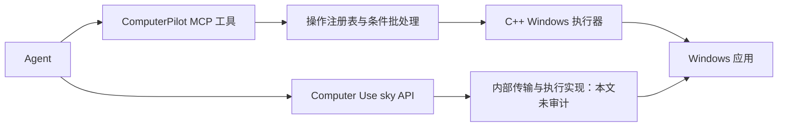

# ComputerPilot 与 Computer Use 协议及 Agent 接口对比

> 历史分析：下文记录旧版接口。当前 ComputerPilot 已收敛为四个工具，computer_*、独立等待和 before/after 不再提供。现行用法以 [MCP.md](MCP.md) 为准。


> 历史基线：本文对比重构前的接口。现已增加 desktop_* 常用层；当前用法以 README、MCP.md 和 AGENT-API.md 为准，第 7 节的部分建议已开始实现。

日期：2026-09-16。用途：说明当前接口差异，解释冷启动失败，并为后续 Agent 接口设计提供依据。

## 1. 结论与对比范围

ComputerPilot 当前具备结构化窗口查询、窗口绑定输入、条件批处理、字段回读、执行环境诊断和实验性应用语义，但默认入口仍让 Agent 处理较多底层细节。Computer Use 的本机 `sky` API 更集中于明确的目标窗口与观察状态，减少了调用时的选择和换算负担。

建议保留 ComputerPilot 的 C++ 执行器与 MCP，增加面向 Agent 的简单接口，并把可靠的应用操作封装到中间层。无需为了模仿 Computer Use 改用 Node 实现核心，也不能期待只改方法名称就解决绘图问题。

本文对比的 Computer Use 是本机安装插件 **26.908.70816** 中的 `@oai/sky`、`window2` API 及其使用指南。它不等同于所有 OpenAI Computer Use 产品，也不代表公开 API、其它客户端版本或其内部传输协议。本机另一个 `cua_repl` 接口不纳入此表。

历史快照：本文基于 0.3.0 时期的工作区源码和文档，包含当时尚未发布的桌面预检改动；其中“当前没有 Aseprite 专用语义”等描述不代表 v0.5.0。本文没有通过一组受控实验比较两者的成功率、延迟或 token。

证据标记：**已实现**指当前代码可定位；**已公开**指本机插件文档明确描述；**观察**指本次运行记录；**建议**指尚未实现的设计。未在 Computer Use 文档中找到某能力，不等于底层一定没有。

## 2. 先区分三个层次

| 层次 | ComputerPilot | 本机 Computer Use |
|---|---|---|
| 通讯与生命周期 | MCP JSON-RPC 2.0 stdio、原生 JSONL、直接 C++ 库；可用持久进程或文件通道 | Agent 从持久 JavaScript 会话导入 `@oai/sky`；底层线协议不在本次公开文档范围内 |
| Agent 可调用接口 | 七个 MCP 工具，主要接收 `operation`、开放结构的 `args`；另有语义入口 | `list_apps`、`get_window_state`、`click`、`press_key` 等明确方法及类型 |
| 执行与验证 | 原生窗口/UIA/输入、执行环境检查、可选几何和前后条件、应用适配器 | 每个输入明确目标窗口，支持状态截图与元素索引；指南要求操作后刷新观察 |

因此，不能把“JSON-RPC 与 JavaScript”直接作为能力或可靠性的优劣对比。一个 C++ MCP 服务同样可以暴露简单、明确的 Agent 接口。



## 3. 当前接口对照

| 维度 | ComputerPilot 当前实现 | Computer Use 本机公开接口 | 对 Agent 的影响 |
|---|---|---|---|
| 入口发现 | 配置 MCP；否则找到二进制并使用 serve/jsonl；已有 skill 安装提示 | 导入指定包，再列应用/窗口 | 未配置 MCP 的 ComputerPilot 会增加启动与通讯工作 |
| 初始化 | MCP initialize → initialized 通知；文件通道每次重启服务 | 初始化一次 sky 对象，持久会话保存窗口与状态 | 持久连接可减少重复发现和引用失效 |
| 工具结构 | runtime/query/inspect/act/batch/wait/semantic 七个工具 | 面向操作的方法和明确输入类型 | 工具数量少不等于学习成本低；operation/args 仍须查注册表 |
| 参数 schema | 通用工具的 args 为 object，批次 step 也较宽泛，主要由运行时校验 | click、drag、press_key 等各自明确字段 | ComputerPilot 对字段拼写、组合和按键格式的提前指导不足 |
| 窗口选择 | window.list、window.get 等返回 windowRef | list_apps/list_windows 返回 Window，get_window 可重新获取 | 两者都要求从实际结果选择目标，不能猜造引用 |
| 输入窗口绑定 | 相对输入必须带 windowRef；旧式屏幕输入仍可省略 | 各输入方法要求 window | ComputerPilot 默认可走不绑定窗口的路径，本次失败实际使用了它 |
| 默认坐标 | 原生输入默认 screen_physical；可选 window_relative/client_relative/image_pixels | click/drag 为窗口相对坐标 | 统一窗口坐标可降低手动加减窗口原点的错误 |
| DPI 与像素 | 窗口/客户区相对坐标以物理像素定义；图像映射由 imageRef 支持 | API 定义窗口相对位置，截图元数据含逻辑尺寸与原点 | 不应假定单位相同；兼容层必须明确转换契约 |
| 状态获取 | window.get、ui.tree/find、capture.window 等分开；可组合，inspect.hybrid 另有模型参数 | get_window_state 统一返回窗口、可访问性信息和截图集合 | 统一轻量状态入口更易形成稳定工作循环 |
| 图像关联 | image_pixels 可关联当前会话 imageRef，窗口几何改变会失效 | 坐标动作可附 screenshotId，要求属于目标窗口缓存 | 关联观察优于孤立坐标；均不能因此假定颜色和画布缩放仍正确 |
| 控件关联 | 不透明 elementRef；支持查询、属性与 UIA 操作 | 最近状态中的 element_index | 索引较短，但有效期必须随观察更新；引用也不可跨会话使用 |
| 焦点处理 | 绑定输入要求目标已在前台，默认不自动抢焦点 | 文档说明输入会自动激活目标窗口 | 前者显式、后者调用省事；需要考虑用户同时操作的干扰 |
| 键盘表达 | input.key_chord 使用 keys 数组与实现支持的键名 | press_key 使用组合字符串并接受常见别名 | 统一别名和清晰错误能减少无效重试 |
| 文本填写 | ui.fill/ui.fill_form 可替换、回读；原始 type_text 只负责输入 | type_text 面向当前焦点；set_value 面向可编辑元素 | 两者都不能将“已输入”直接理解为应用已接受 |
| 批处理 | 内建顺序步骤、step refs、默认参数、延迟、前后条件、失败停止 | 本机 API 列表未公开同等条件批处理接口；指南要求单步后观察 | ComputerPilot 适合稳定动作序列，但前提未核验时会放大错误 |
| 内部等待 | computer_wait 和 before/after 支持只读条件轮询 | 本次 API 文档未公开对应通用条件等待接口 | 可以减少 Agent 轮询；不要以“未公开”断言完全不支持 |
| 结果输出 | structuredContent/等价文本、summary/last/all、可选 metrics | 方法返回 WindowState 或完成/异常等 | ComputerPilot 可精简输出，但调用方需正确解读执行与验收边界 |
| 失败与去重 | 同会话 requestId 去重、action.status、取消/超时、部分完成信息 | 指南强调未知结果先重新观察；同等级去重语义未在所读 API 中公开 | 跨会话 exactly-once 不能假定；重试前必须确认是否已经生效 |
| 桌面诊断 | doctor、system.preflight，启动提示；serve/jsonl 在环境不适用时阻止桌面派发 | 所读 API 未提供同名显式诊断方法 | ComputerPilot 已将环境问题变成结构化前置条件 |
| 应用语义 | 经典 Paint 实验性 profile；当前没有 Aseprite 专用绘图动作 | 所读 API 提供通用桌面动作，无 Aseprite 专用语义 | 复杂应用的可靠步骤仍需适配层或模型自行完成 |

说明：ComputerPilot 的全局桌面预检并没有取消旧式、未绑定窗口的屏幕输入。前者检查执行环境，后者关系到具体输入目标，是两项不同检查。

## 4. 同一操作的表达差异

下面只展示接口形状，窗口引用、截图和坐标必须来自当前观察，不可直接照抄执行。

### ComputerPilot：当前 MCP 操作参数

```json
{
  "name": "computer_act",
  "arguments": {
    "operation": "input.click",
    "args": {
      "windowRef": "RETURNED_WINDOW_REF",
      "coordinateSpace": "window_relative",
      "expectedSize": {"width": 925, "height": 690},
      "x": 420,
      "y": 260
    }
  }
}
```

这是 tools/call 的 params。使用原生文件通道还需 JSON-RPC 外壳和初始化；已注册 MCP 时客户端承担这些工作，Agent 无需手写握手。批处理可把 windowRef、坐标系和尺寸放进 inputDefaults，避免每步重复。

### Computer Use：当前公开 API 形状

```javascript
await sky.click({
  window: observedWindow,
  screenshotId: observedScreenshotId,
  x: 420,
  y: 260
});
```

优势在于目标窗口和坐标语义更集中，不是 JavaScript 本身使输入更可靠。完整工作仍包括获取窗口、查看状态、判断位置及操作后刷新；不能只比较这一行与完整 JSON-RPC 握手的字符数。

## 5. luna 冷启动失败：协议暴露了什么问题

测试配置为 gpt-5.6-luna、medium、不继承历史，使用已安装 skill 和小鸟参考图，通过 ComputerPilot 操作 Aseprite。以下是一次实际观察，不是模型总体能力结论。

### 已确认事实

- 初次预检发现 restricted_execution_token；调整到宿主许可的交互执行环境后通过。新桌面诊断在这一步发挥了作用。
- 已创建 32×32 文档，未保存，未调整窗口大小。
- 绘图批次包含 422 步，返回 status:ok、completed:422。
- 批次未设置 inputDefaults；大量鼠标与键盘步骤没有 windowRef。仅最初激活窗口，不能保证整个序列始终作用在正确位置。
- 设置颜色使用“点击 → Ctrl+A → 输入色值 → Enter”，随后直接绘制，没有颜色回读或试画核验。
- 观察到窗口屏幕原点为 (248,740)。第一个绘图点 (512,992) 换算为窗口内 (264,252)，而此前截图的画布左缘约为 305；该点已在画布外。
- 最终截图显示 1600% 缩放和错误色块，没有形成小鸟。首次预检请求到最后截图约 7 分钟，不包括最初准备。

### 可以得出的结论

这次不只是模型不擅长绘画：输入目标与坐标映射错误、状态未验收、大批次延迟发现错误，均有直接证据。当前接口允许模型绕开文档推荐的窗口绑定方式，并且通用批次并不理解“这一段是在画布上绘图”。

无法仅凭最终截图确定哪一个事件使缩放变为 1600%，也不能证明所有颜色设置都未生效。422 步完成只是执行层结果，并不证明 422 步符合用户意图。文档增加提醒能帮助 Agent，但不能替代程序中的必填参数、范围检查和应用状态核验。

### 故障对应的改进层次

| 故障 | 应承担的层次 | 具体改进 |
|---|---|---|
| 隔离桌面输入无效 | 执行环境 | 已新增启动预检、结构化提示和派发前停止 |
| 未绑定窗口 | Agent 接口/schema | 简单输入接口强制目标窗口；原始屏幕操作单独明确暴露 |
| 窗口原点换算错误 | 坐标映射 | 统一截图/窗口坐标，程序负责坐标转换 |
| 点落在画布外 | 应用适配器 | 验证逻辑像素与可见画布范围，不仅验证窗口范围 |
| 颜色/缩放未确认 | 应用状态转换 | 设置后回读或可验证观察；确认后才运行绘制组 |
| 数百步后才发现错误 | 条件批处理 | 在状态转换处检查；稳定笔画内部高效批量执行 |
| 模型仍需理解绘画结构 | 内容规划与视觉验收 | 独立审查像素计划与参考图，不用执行成功替代美术判断 |

## 6. 借鉴 Computer Use 的部分与保留 ComputerPilot 的部分

应借鉴：明确的目标窗口、较少的坐标选择、统一观察入口、可关联观察的动作、清楚的按键别名、持久会话和具体参数类型。这些设计减少模型需要自行维护的状态。

应保留：原生 C++、MCP、字段回读、条件批处理、内部等待、紧凑输出、部分失败报告、应用语义及可选底层能力。它们适合减少重复交互与高频绘图开销。

不建议机械复制指南中的逐个输入后截图，应用到几百个像素上。更合适的是：选择工具/设置颜色/切换缩放后验证，随后将已验证状态下的一组笔画交给中间层执行，再做组级验收。

不要承诺通过采用相同方法名就能获得 Computer Use 的模型熟悉度、训练效果或成功率；本次没有这种证据。也不要将此前浏览器 URL 校验中断，直接用作两种桌面绘图接口可靠性的比较结论。

## 7. 建议的目标接口：尚未实现

### A. 简单 Agent 层

提供明确的 select/observe/click/type/key/drag/batch 接口，各自具备具体 schema。实际命名应在实现前统一，这里不作为可调用 API。

- 目标窗口必填，或通过一个显式创建的目标会话绑定；不依赖模糊全局“当前窗口”。
- observe 返回窗口、截图、控件引用、坐标单位及可检验的几何版本。
- Agent 默认使用这一观察定义的坐标，不自行加屏幕偏移。底层处理 DPI 和截图缩放。
- 几何版本可以发现移动/尺寸变化，但不能证明应用内部缩放、工具或颜色未变；这些由应用状态检查负责。
- 未知按键在派发前报出支持的别名；不让模型反复试猜。
- 状态不成立返回结构化原因、未执行部分和恢复建议；不默默点击别处。
- 原始操作注册表继续保留为高级入口，避免破坏已有消费者。

### B. Aseprite 语义层

建议新增的能力是新建并核验画布、设置并核验颜色、读取画布映射、执行像素网格。当前没有这些专用动作，不能直接调用。

Agent 提供尺寸、调色板、行网格或像素段。中间层负责核验画布、选择一像素铅笔、设置颜色、合并连续段、执行和检查。范围错误应在任何绘图前拒绝；动态状态失效时停止剩余部分。

应分别返回：环境是否可用、前置状态是否确认、派发完成数量、执行结果验证，以及是否还需人或 Agent 对参考还原质量进行判断。`drawn` 与 `verified` 不应混成一个 success。

### C. 渐进实施顺序

1. **先降低调用错误：** 注册持久 MCP、补具体操作 schema、统一按键别名和窗口绑定。
2. **再降低状态错误：** 实现统一观察、明确坐标契约、几何失效与前置状态检查。
3. **再降低重复操作成本：** 实现 Aseprite 适配器与组内状态复用。
4. **最后做受控冷启动对照：** 固定应用版本、窗口/DPI、参考、模型和推理配置，比较完成率、人工协助、工具往返、耗时和有效验收。

原始兼容入口与新默认入口需要分别测试；拒绝未绑定的简单接口输入，不应悄悄改变所有既有低层客户端的行为。无需引入新的脚本运行时才能实施以上变化。

## 8. 验收方法与当前限制

建议至少覆盖：桌面不一致、受限令牌、错误按键、缺失窗口、窗口尺寸变化、画布缩放变化、颜色设置未生效、批次中途被打断、最终像素差异。分别记录派发前拒绝、部分执行和未知结果，不能把它们归为同一种失败。

新 Agent 只接收正式文档和参考，不提供旧坐标、旧任务脚本或成图。人工提示必须计数。token 只有在取得可靠计量时才报告；命令数、文件大小和原生批次耗时都不能替代 token 或完整任务耗时。

现有 8×8 入门示例验证的是专用测试窗口的通讯、定位、组合输入和截图结果；它不证明 Aseprite 通用适配已完成。luna 此轮失败也不能单独证明换成 Computer Use 就会成功，后者尚未在相同条件下进行本次绘图对照。

## 9. 依据与相关资料

ComputerPilot 可审计来源：

- [MCP 接入](MCP.md)、[协议与执行语义](PROTOCOL.md)、[操作参考](../OPERATIONS.md)。
- [窗口绑定与条件批处理](../BATCH-RELIABILITY.md)、[语义适配及验证范围](SEMANTIC-PROFILES.md)。
- [MCP 工具 schema 与分发](../src/server.cpp)、[注册表与图像映射](../src/service.cpp)、[窗口检查与原生输入](../src/desktop_windows.cpp)、[桌面预检](../src/preflight.cpp)。
- [Agent skill](../skills/computerpilot/SKILL.md)、[Aseprite 指导](../skills/computerpilot/references/aseprite.md)、[入门示例](../examples/onboarding/README.md)。

Computer Use 来源为本机插件 `computer-use/26.908.70816` 包内的 `skills/computer-use/SKILL.md`、`docs/api.md` 和 `docs/guidance.md`。这里只引用接口名称并概述其契约，未复制实现，也未审计内部线协议。插件升级后需要重新核对。

本次 luna 证据是本地 `inspect_batch_out.jsonl`、`zoomfield.jsonl`、`zoomed.png`、`draw_stage1.jsonl`、`draw_stage1_out2.jsonl` 和 `bird_stage1.png`。这些是会话产物，不作为库的运行依赖或公开分发材料；上述正文保留了用于推导结论的具体字段和观察。
