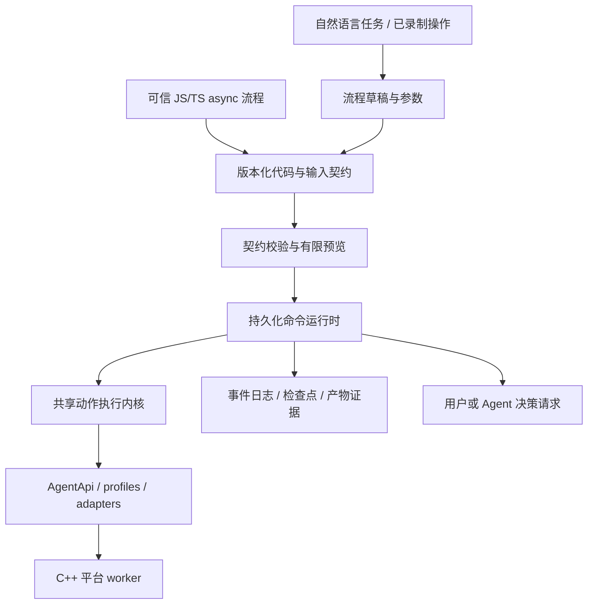

# 动态编排设计讨论稿

日期：2026-09-25。代码基线：`refactor/node-orchestration` / `906bb64`。
状态：历史架构讨论与后续演进提案。下文“代码现状”以以上基线为准，不代表当前实现状态。首版已收敛为文件批次 CLI 并完成本机验收，操作和证据分别见 [使用指南](../guides/WORKFLOW.md) 与 [验收记录](../validation/WORKFLOW-ACCEPTANCE.md)。完整 async 宿主命令恢复、用户回答和跨应用编排尚未实现。

产品范围补充：见 [产品定义与首版范围](WORKFLOW-PRODUCT-SCOPE.md)。首版以文件产物型批次、同机复用和项目边界恢复为交付承诺；下文完整 async 历史恢复、跨应用与外部决策为演进设计，不是首版必须全部完成。开发顺序以产品文档的完整业务闭环为准。

## 1. 结论与范围

后续架构建议把现有 Replay 的执行保障抽为共享内核，增加可信本地 JS/TS async Workflow 作者接口。该演进方案拟持久化受控的宿主命令，覆盖观察、输入、等待、用户回答和外部决策；普通计算使用 JS。恢复时从入口重新运行纯逻辑，按顺序消费历史命令结果，到未执行边界才继续现场操作。当前首版仅持久化逐项导出/跳过决策与文件产物状态，未实现本段的通用命令历史重放。

不保存 JS 调用栈，也不提供任意 `effect(fn)` 的可靠恢复承诺。代码、依赖、输入或命令历史不匹配时停止；存在未决输入时先核对。声明式动态图也能通过运行时引用、foreach 和决策节点覆盖许多场景，选择 JS 是为了自然表达临时任务和复杂数据转换，避免首版同时建设一套表达式语言与图编辑器。

产品首先服务一次性长批次，以及“Agent 做过一次，用户换一批输入继续做”的过程。用户主要看到输入、运行进度、结果和需要处理的异常；JSON、JS 和节点图是作者与诊断界面。

## 2. 代码现状与真实缺口

| 部分 | 当前实现 | 对编排的影响 |
|---|---|---|
| Node/C++ 边界 | Node 管 MCP、profile、适配器、视觉与 Replay；C++ 是平台 worker | 编排放在 Node，无需把业务重新塞回 C++ |
| Delta | `node/src/agent/api.ts` 管观察基线、控件差分和图像 patch；代数、视图、几何、完整性不满足时返回 full | 属于观察传输优化，不能充当流程检查点或文档身份 |
| Replay | `replay/recipe.ts` 定义固定 steps；`runner.ts` 逐步发现唯一窗口、检查 before、派发、等待 expect、commit | 现有动作闭环值得复用，但 runner 与线性序列、单目标绑定 |
| 恢复 | `recovery.ts` 识别已提交前缀；要求下一步强 before；未决 intent 停止 | 需要扩展为节点实例、循环游标、分支决策、持久化变量，不能只保存 step index |
| 录制草稿 | 单动作且已确认的语义调用可生成草稿；基础输入、多动作等不转换 | 录制不能自动推断哪些字面量是变量、为什么选择分支或如何验收 |
| 并发 | Replay 持整次运行的桌面锁；MCP 的输入和状态读取使用同一锁 | 增加人工暂停、跨应用和长等待前，要定义让出桌面的边界 |
| 验收等级 | runner 仅把每步含文件 SHA-256 的全流程标 verified；其它记 partial | 已有图像参考比较，但日志分类粗，不能把所有非哈希证据说成 profile 检查 |
| Aseprite | manifest 暴露 keyChord/selectTool/zoom/click/saveAsDefault/openMenu | 通用打开文件、指定路径导出、读取文档身份尚非完整语义能力；批量导出需先补适配器 |

`docs/validation/DELTA-REPLAY-RELEASE-ACCEPTANCE.md` 记录了本机短流程 10/10 和中断/锁等实验，也记录了人工画线逃过三点采样。它没有证明任意长流程、异机分享或真实 Delta token 收益。不能把已有短流程证据直接外推为动态编排稳定性。

当前分支 `AGENTS.md` 将公开 schema 来源更新为 `node/src/mcp/tools.json`；保持四个公开 MCP 工具。流程管理先走 CLI/本地控制通道，不把控制命令伪装成第五个工具或 `execute_batch` 的脚本字符串。

## 3. 用场景决定能力

| 用户任务 | 流程需要的动态行为 | 成功标准与中断处理 |
|---|---|---|
| 把一批 Aseprite 素材导出为 PNG | 固定输入清单、每项稳定身份、逐项路径、检查已有产物、失败项处理 | 每项关联源文件摘要与导出参数；校验产物格式/尺寸/内容需求。恢复不重做已验收项，也不把旧同名文件当本次产物 |
| 从应用 A 取数据，填到应用 B | 多个目标别名、结构化字段提取、逐条循环、目标记录唯一匹配 | 先确认记录身份；填入后回读字段；提交动作与草稿填写分开，提交不明时查回执或业务记录 |
| “照刚才的流程处理这个文件夹” | 录制轨迹转草稿、参数提取、运行时弹窗分支 | Agent 提出变量和验收，用户只补无法推断的业务规则；不能仅把全部点击再放一遍 |
| 出现保存提示/格式警告 | 已知弹窗的显式分支，未知界面转暂停 | 不使用全局“遇到对话框就按 Enter”；识别弹窗所属目标与内容后处理 |
| 用户接管修正画面再继续 | pause/yield、变更后的文档重新绑定与检查点 | 恢复时展示现场差异；用户认可改变形成新基线，不冒充原始基线仍成立 |
| 做到第 20 项时修改缩放比例 | 安全边界暂停，创建运行修订，只影响未开始项 | 已完成项保留原参数和证据；当前未决项先核对，不悄悄改参数后重派 |
| 界面状态需 AI 判断 | 有界的外部决策请求，返回结构化选择或补充计划 | 设置超时和次数；记录回答、证据和计划差异。没有 Agent 响应时可暂停供人工处理 |

优先用已有可靠 Paint 动作跑通编排闭环，再用 Aseprite 批量导出推动适配器补齐。跨应用填表是第二个架构验收场景，不宣称当前已有通用表单适配器。

## 4. 分层及作者接口



首版宿主命令为 `readInput`、`observe`、`step`、`waitFor`、`ask`、`checkpoint`；加上 `withDesktop` 管理桌面段，`item` 管理稳定项目身份与进度。for/if 和纯数据转换直接使用 JS。复用采用带稳定命名空间的普通函数；不首发通用 DAG 并行调度。

- `readInput` 固定文件清单/来源摘要。目录扫描结果记录后不因重启重新扫描；动态采集得到的列表也先提交再迭代。
- `observe` 返回不可变、可序列化的完整逻辑观察及证据。恢复历史时返回当时的数据，不能把它标成新鲜现场。
- `step` 接收动作描述而非任意回调，包含 target、profile、args、before、expect 和超时；内核执行当前窗口绑定与新鲜重验。优先语义动作；基础输入必须从新鲜观察定位，不持久化临时控件引用。
- `waitFor` 通过内核限时轮询，只重复观察。保存原截止时间；恢复后不能把预算无限重新计时。
- `ask` 记录问题、结构化回答和证据；可由用户或外部 Agent 响应，没有自动接入某个模型的假设。复杂计划回答须经动作 schema 与既有授权范围校验。
- `checkpoint` 是可选业务边界，基础动作提交自动完成，用户不必为每次点击手写检查点。
- 条件返回 match/no_match/unknown。观察失败、截断和目标歧义必须抛出可分类异常或显式 unknown；不得通过 JS 真值转换当成 false 继续。

以下仅是拟议接口，不是现有可运行示例。`exportSprite` 子流程和文档观察 view 需另行实现并验收；示例不宣称当前 Aseprite 已支持指定路径导出：

```ts
export default async function run(ctx, input) {
  const assets = await ctx.readInput('assets', {
    files: input.files, maxItems: 500, key: 'id'
  });
  for (const asset of assets) {
    await ctx.item(asset.id, async item => {
      await item.withDesktop('editor', async desktop => {
        const observed = await desktop.observe('inspect', {
          target: input.editor, view: 'document'
        });
        // 普通分支依据已持久化的观察；unknown 会在读取处停止。
        const format = observed.hasAnimation ? 'sheet' : 'png';
        await exportSprite(desktop, asset, format);
        // 子流程内部仅调用 step 描述已安装动作，声明 before/expect。
      });
      await item.checkpoint('complete');
    });
  }
}
```

每个宿主命令有稳定 ID，项目/子流程前缀自动命名空间化。循环需稳定 itemKey、项目数和运行时限预算；纯 JS 死循环由独立子进程的宿主 watchdog 终止，终止不能被解释成已撤销派发。脚本进程发结构化命令给宿主，宿主管 journal、run lock 和 worker，避免脚本事件循环阻塞后无法停止。

默认预览只读 manifest/参数声明和既有轨迹，不 import 未信任脚本。它显示预期输入、已声明能力、产物范围和动态部分，不能保证列出任意 JS 所有分支；宿主在运行时仍验证每条命令。执行轨迹是一次运行的证据，不等同可覆盖所有输入的流程图。

本地 JS 不是沙箱：子进程隔离便于停止与容错，不阻止作者绕过 SDK 使用 fs/network/child_process。可信脚本的恢复契约明确禁止宿主接口外的副作用与非确定性输入；第一版不提供通用网络 effect 回调。分享保留两种清晰格式：现有声明式 recipe v1；标为可信代码的 workflow 包。后者校验可检查摘要和 manifest，但不能声称已证明任意源码无副作用。不得把 `node:vm` 宣称为安全隔离。

## 5. 动作与流程状态必须分开

动作状态：`pending → checking → intent_durable → dispatched → receipt_durable → verifying → committed`。持久化的 intent 不等于证明已派发；崩溃发生在二者之间时仍按未决处理。

运行状态：`created/running/pausing/paused/waiting_decision/needs_reconciliation/completed/completed_with_errors/cancelled/failed`。批次进度分别统计成功、失败、跳过、未决和未开始，不能把跳过项算成功。

核心规则：

1. 派发前同步持久化完整的规范化动作参数或其可重建记录、输入摘要、目标身份、前置证据和唯一节点实例 ID。
2. 回执与内容验收分别记录。发送成功不能代替业务成功；验收失败不能自动重新发送动作。
3. 已提交动作不重放。缺失回执、部分执行、取消后未知结果进入核对状态，停止当前桌面链。
4. 只读请求可以有界重试。首版写操作即使 `not_started` 也走显式恢复，重新发现、验证并记录新 attempt ID 与原因；不得把旧失败回执当作成功输出。后续只有声明了逐动作恢复契约的能力才允许有限自动重试。
5. JS `catch` 不得吞掉 unknown 并继续点击。宿主把运行锁定为 `needs_reconciliation`，即使脚本捕获异常并再发 step，宿主也拒绝派发；只有核对事件解除此状态后才能继续。
6. 暂停在动作安全边界生效。立即停止可能杀死 worker，从而产生未知结果；界面必须说清“已请求停止”与“已停止”的差别。

不提供通用回滚。输入、提交和保存通常没有事务；补偿必须是显式能力，并满足独立的 before/expect。

## 6. 恢复模型与动态参数

每个命令实例用 `runId + workflowRevision + scopePath + itemKey + commandId` 定位，另有全局递增 seq；不用易变化的数组索引或窗口句柄作身份。保存代码/依赖摘要、输入快照、profile 版本、已解析参数、观察输出、回答、证据和提交事件。

从入口重跑脚本时严格按序消费旧历史，而非仅按 ID 查一个缓存。每次调用核对命令类型、稳定 ID 和规范化参数摘要，然后返回已提交输出。出现多命令、少命令、顺序变化、重复 ID、参数漂移或脚本提前结束都拒绝续跑。规范化定义 object key 排序与 JSON 值限制；禁止 NaN、函数、循环对象和隐式路径转换混入摘要。

普通 if 从历史观察推导同一分支；关键业务决策可追加具名 decision 事件以便展示。时间、随机数、用户回答、文件内容与外部读取不能直接影响恢复逻辑，必须固定在输入或通过记录型宿主命令取得。首版没有宿主接口覆盖的外部效果不纳入可恢复模式。

到达历史末尾第一个新动作时，重新获取现场并检查 before；历史观察仅用于复现过去决定。若现场使旧决定失效，应暂停或创建显式新决策修订，不能自动把旧 observe 替换成新结果而改变历史。已提交 step 返回序列化的业务输出与证据，不返回可再次操作的旧 window_id/control_id。

运行日志再配一个独立的 run lock，覆盖 inspect → 决定恢复位置 → 追加事件，防止两个进程同时续跑。桌面锁不能替代它。尾部半行、序号断裂、摘要不符均保守停止；定期检查点只是索引，事件日志仍为事实来源。

当前 runner 在获取桌面锁之前 inspect 并打开日志，存在检查与使用之间的竞态窗口。现有锁冲突会立即失败，并不是排队等待；但检查后被调度挂起、另一运行完成并释放锁后再取得锁的情形仍可能使用旧 startIndex。P0 应在持有 run lock 后重新读取日志，不能只依赖当前桌面锁拒绝并发。

核对未决动作时允许：

- 通过针对该动作的强证据确认已经完成，追加 reconciliation 与 commit；只检查“文件存在”不够，要排除旧产物。
- 证明没有生效后，追加原因并创建新 attempt；原 intent 不删除。
- 证据不足时由用户接管、放弃当前项或终止。人工声明与机器验收分别标注。

参数变更形成新修订，并保留来源 run；未开始项使用新参数，完成项仍关联旧参数。首版可以用“从剩余项创建派生运行”实现，避免任意在运行中的图迁移。未知项不可直接塞进新运行当作未开始。

## 7. 桌面锁与人工接管

桌面输入按同一 Windows 会话串行。`get_window_state` 默认会激活窗口，也必须纳入协调；两个不同应用不等于两个独立输入资源。

推荐将运行拆成明确 desktop segment：从重新绑定文档、检查现场，到完成一组不能被穿插的动作及验收。segment 持锁；人工暂停、网络等待和批次项目之间可让出。首版默认每项一个 segment，避免任意每个小动作都放锁导致剪贴板/弹窗/选区被穿插。长动画等待设上限；需要让出时先保存检查点，重新取得锁后重验。

恢复历史期间，`withDesktop` 只重建逻辑作用域，不激活窗口、不持桌面锁；到该作用域第一条新现场命令才实际取锁。`item`/`withDesktop` 的回调只组织命令，不是可持久化的任意 effect 回调。`ask` 在段内必须显式结束/挂起 segment，记录让出事件后释放锁；回答到达后重获锁并检查现场，不沿用原选区或弹窗假设。若任务无法构造有效恢复基线，禁止在该段中间挂起，选择段前提问或终止接管。

等待预算跨恢复保留；桌面段设置最长占用时间，脚本总预算与外部决策次数也持久化。创建运行时固定预算；ask 使用独立 TTL，可暂停有效工作时长计费，过期转 paused。子进程每次启动有 watchdog，但累计重启/命令/项目上限不重置。过期等待可以补做一次只读核对并记录证据，不能重新派发动作或无限重置期限。

run lock 从读取历史前开始，由唯一活跃宿主持有到执行结束，包含脚本重放和等待回答期间。控制请求由该宿主串行处理，不直接由多个客户端追加日志。宿主要退出时先持久化暂停状态、停止接收/派发命令并结束脚本，再释放 run lock；后来者重获锁并重读状态。崩溃恢复核对进程启动身份，拒绝旧宿主请求；如果未来引入可过期 lease，必须另加 fencing，不能让两个宿主同时成为 writer。

输入锁与 run lock 的所有权独立，获取顺序固定为 run → desktop。提取共享执行内核时传入受控 lease/context，避免 Replay 已持锁后再走 MCP wrapper 二次取锁。改进锁身份时应由 worker 提供真实用户 SID、Session ID、输入 desktop 和进程启动标识，不能只依赖环境变量和 PID。

锁只协调本工具，无法阻止用户或其它自动化输入。状态差异检测只能发现可观测变化，不能保证发现所有干预。用户点击“接管”后释放桌面，保留运行；继续时重新验证文档与目标。

## 8. Delta、证据和运行界面

内核对条件使用完整的逻辑状态。Delta 只用于状态展示或减少传输；不得让表达式直接在 patch 上判断控件是否不存在。面向多个订阅者时增加显式 stream/baseVersion/version；消费者发现缺口、重连或 worker 变化就取 full。运行界面的订阅不得改变动作侧的“最后观察”或抢焦点。

分别显示 execution 与 verification。证据保存 verifier 类型、作用范围、期望/实际摘要和产物路径，例如 control-value、file-metadata、file-hash、image-reference、manual-acceptance。哈希只能证明符合对应文件期望，不能泛化为用户整个任务正确；不同任务选择不同验收契约。

运行界面建议包含：

- 当前项目/步骤、已完成数量、等待原因、最近一次动作与验收。
- 参数与输出目录、失败/跳过/未决项列表、可直接打开的产物证据。
- 安全暂停、单步、接管、继续、停止；按钮可用性由运行状态决定。
- 故障卡给出“发现什么、已发生什么、可采取什么操作”，例如“保存可能已生效，正在核对目标文件”，避免泛化成“重试”。

不要首发拖拽流程图编辑器。先提供可读结构预览、参数表单和运行时间线，验证流程模型后再做可视化编辑。

## 9. 落地顺序与代码位置

以下为技术模块拆分，不代表按模块全部完成后才交付业务场景。产品首版应先验证一个文件处理/导出能力，再形成窄批次闭环、项目边界恢复和动态作者体验。完整命令历史回放可随后建设，不把任意项内恢复作为上线前提。

| 阶段 | 工作 | 完成判据 |
|---|---|---|
| P0 共享执行边界 | 从 `replay/runner.ts` 提取 target 绑定、动作、验证、事件写入；强化证据分类与 run lock | v1 recipe 行为保持兼容；未知结果和旧引用仍拒绝继续 |
| P1 动态内核 | 新建 `node/src/workflow/{commands,host,script-runner,journal,recovery}.ts`；实现稳定命令顺序、历史输出回放、输入冻结与 step | 已有 Paint 能力完成 JS 批次；重启后项目身份、分支和产物一致 |
| P2 作者与交互 | `workflow/sdk.ts`、独立 CLI、本地控制通道、wait/ask/item、草稿参数化、有限预览与时间线 | 用户可修改输入再运行；无需手写完整 JSON；可明确核对未决项 |
| P3 场景能力 | 补 Aseprite 文档定位/指定路径导出与验收；跨应用目标和字段提取；有限 Agent 决策接入 | 真实批量和跨应用用例，包括人工接管、弹窗、参数变更 |
| P4 按需扩展 | 可视化作者界面、声明式工作流图、数据处理并行、额外外部连接器 | 真实场景支持投入；仍复用宿主命令内核与恢复约定 |

`replay/conditions.ts` 的匹配逻辑可复用，但要从字符串 problems 提升为 match/no_match/unknown 及结构化证据。`replay/recovery.ts` 保持 v1 检查兼容，Workflow 使用独立 schema/version，不直接让旧解析器忽略新日志事件。`replay/record.ts` 与 `draft.ts` 继续作为轨迹来源；新增草稿语义层，不放松未知结果过滤。

拟议 CLI：`workflow validate/plan/run/status/pause/resume/reconcile`。尚未实现；控制通道应有运行身份与访问约束，不把任意执行器暴露为无认证网络服务。

## 10. 验收计划（本轮未执行）

必须覆盖：运行时分支；unknown 不落入 else；重复 itemKey；输入清单变化；每个持久化边界崩溃；intent 已写但输入未知；回执已到但 commit 未写；两个进程续跑；worker 重启；锁屏；模态窗口；暂停期间用户修改文档；Delta 基线丢失；参数修订；旧产物同名；基础输入坐标过期。

业务验收先做 20 项以上批次，在中段故障后核对“无重复写、无静默漏项、未决项明确、产物对应参数”。再做跨应用任务，确认目标歧义和提交不明都能停止。记录首建耗时、后续执行耗时、成功/失败/未决项、人工干预次数；Delta 单独配对测量字节、时延和真实模型 token，不能用合成字节缩减代替效果。

实现时按分支 AGENTS.md 运行 Node 与平台 worker 非交互测试；真实桌面案例只使用一次性文档。设计稿本身不要求启动用户应用。

## 11. 讨论后的取舍

三方共同认可共享执行内核、持久化决策输入、强恢复边界和桌面串行。第一轮偏向 JS 构图；第二轮产品评审用临时 AI 决策和复杂数据流挑战作者体验，架构评审随后支持收窄的 async 宿主命令模式。实现评审强调：现有 runner 不能直接承担该契约，必须先抽出执行内核和改写恢复协议。

最终建议选择“可信本地 async JS + 持久化宿主命令”，不承诺通用 durable JS。动态图并非做不到实时分支或变长循环；这个选择是为了减少新语言负担，同时接受可信代码与有限预览的代价。锁采用显式 segment，默认每个业务项目持有，暂停时让出。任意绕过宿主接口的 JS 副作用不在恢复保证内；运行轨迹也不能无条件转换成覆盖所有分支的可移植 JSON 流程。
