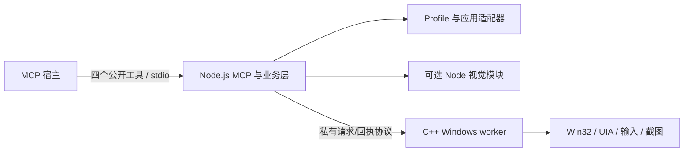

# DesktopPilot：Node.js 业务层与 C++ 原生执行层重构计划

状态：实施中，Node 服务和 C++ 平台 worker 已贯通，旧 C++ 业务构建已改为显式兼容模式；尚未达到正式发行切换条件。当前证据与剩余风险见 [验收记录](../validation/NODE-ORCHESTRATION-ACCEPTANCE.md)。分支：`refactor/node-orchestration`。本分支从当前 `main` 工作区切出，切换分支时已有未提交修改；实施时应逐项识别并保留这些改动。

## 目标和验收边界

目标是让 DesktopPilot 自有 C++ 代码只处理 Windows 会话、窗口、UI Automation、输入、剪贴板和截图等平台操作；Node.js（建议用 TypeScript 编写并编译为 JavaScript）负责 MCP、公开工具、观察状态、profile、语义动作、批次编排、返回内容和未来 replay。跨进程仍保留原生工作进程隔离，避免 UIA 卡住整个 MCP 服务。

公开 MCP 继续只有 `list_windows`、`get_window_state`、`execute_semantic`、`execute_batch` 四个工具。参数、结构化结果、路径优先截图、可选内联图片和错误语义以当前行为为迁移基线；不借重构悄悄增加工具或重解释坐标。`AgentApi::tools()` 在迁移完成前仍是当前 schema 来源；切换后只能有一份 Node schema 来源，并同步修改 `AGENTS.md` 和文档生成器。

这不是把 C++ `Service` 原样包在 Node 外面。最终的原生接口只暴露平台原语，业务判断不得继续藏在 `jsonl` 或动态库中。为了渐进验证，允许短期使用现有 `jsonl` 做 Node 薄包装，但这一中间状态不能算完成。

## 当前代码边界

| 当前模块 | 当前职责 | 目标去向 |
|---|---|---|
| `src/server.cpp`、`src/agent_api.cpp` | MCP stdio、四工具 schema、观察状态、输出内容、输入映射、批次 | Node `mcp`、`agent-api`、`state`、`batch` |
| `src/profiles.cpp`、`src/semantic*.cpp`、`profiles/*` | profile 发现、兼容性判断、Paint/Aseprite 动作 | Node profile 引擎和应用适配器；JSON manifest 保留并明确版本 |
| `src/service.cpp` | 原生操作路由，也混有启动后尺寸准备、截图引用、坐标换算、视觉融合、模型生命周期、去重 | 平台动作留在 C++；编排、引用、视觉融合和回执进入 Node |
| `src/worker_windows.cpp` | 工作进程、硬超时/取消、重启和回执 | Node 进程监督器接管；原生 worker 保留可被终止的进程边界 |
| `src/desktop_windows.cpp`、`src/preflight.cpp` | Win32/UIA、桌面会话、DPI、窗口和输入 | C++ 原生执行层 |
| `src/image_windows.cpp`、`src/core.cpp` | WIC、PNG/WebP、缩放，也有模型预处理、NMS、通用 JSON/图像算法 | 与截图直接相连的解码、缩放和编码可留在 C++ 平台适配器；模型预处理、NMS、结果融合移出本项目 C++ |
| `src/detector_torch.cpp`、`src/ocr_onnx.cpp`、`src/ocr_common.cpp` | 模型推理和结果处理 | Node 可选视觉模块；TorchScript 转换可行性及等价性先单独验证，不能直接删除旧能力 |
| `src/main.cpp`、`CMakeLists.txt` | MCP/JSONL/图像 CLI 及完整 C++ 构建 | 原生可执行文件只承担私有平台协议；Node 启动 MCP/业务 CLI；分别构建、测试和打包 |

## 目标结构

Node 进程由 MCP 宿主在目标应用所在的 Windows 用户会话中启动，并以 `spawn` 启动同会话原生 worker。私有协议推荐先用带请求 ID 的 UTF-8 JSONL 和本机管道；图片传绝对路径及元数据，默认不传 base64。Node 和 C++ 的标准输出均只写各自协议，诊断写标准错误。暂不引入 Node 原生 addon：UIA 的阻塞调用仍须能通过结束工作进程进行硬隔离。

### C++ 原生接口应留下什么

- `system.session`/桌面就绪检查、显示器枚举、进程与窗口发现/激活/关闭/显式准备、DPI 和客户区测量。
- UIA 树、查询、定位、点击、填写和回读；键鼠、剪贴板、截图采集、裁剪、必要的图像编码与物理坐标校验。
- 平台侧输入前的最终检查：窗口引用归属、窗口几何、会话可用性、模态阻挡以及物理坐标有效性。Node 的先前观察不能替代输入时检查。
- 不包含 `semantic.*`、profile 目录遍历、MCP 响应塑形、模型选择、应用菜单流程、业务级重试或 replay。

### Node 应承担什么

- 四工具 schema、MCP stdio、结构化结果与可选图片块，控制紧凑 UIA 输出和截图路径/内联策略。
- 每连接的 `window_id`、`control_id`、截图映射与观察快照；profile 加载、匹配、v1/v2 尺寸门槛和动作示例。
- 经典/新版 Paint、Aseprite 等语义适配器，批次规划、状态机、步骤结果、验证和未来 replay 的前置/后置条件。
- 可选的视觉推理及 UIA/视觉融合。Node API 可以调用第三方原生推理库，但 DesktopPilot 自有 C++ 不再包含模型业务代码。

## 必须保住的执行语义

1. **引用生命周期。** `windowRef`、`elementRef`、`imageRef` 都是单个原生 worker 代内的引用。Node 保存 `workerGeneration`，worker 重启后清空全部观察/控件/截图映射，返回 `referencesInvalidated:true`，要求重新枚举。不能只靠字符串 ID 猜引用仍有效。
2. **串行输入和取消。** 同一个桌面上的动作按序派发。超时/取消若已发给原生进程，结果必须保持 `unknown` 或 `possibly_partial` 的含义；杀掉 worker 不代表输入被撤回。旧 `requestId` 回执缓存迁移到 Node，并保留参数冲突判断；不要自动重放可能已执行的写动作。
3. **观察后重验。** `execute_batch`/`execute_semantic` 在首个输入前重读窗口、显示器 DPI、客户区和必要控件证据。语义适配器按步骤检查结果；单次批次失败仍返回完成数、失败索引和派发状态。
4. **坐标与截图。** 当前 `window_relative_physical_pixels`、`image_pixels`、region 偏移和 `dip96` 客户区的含义分别固定；Node 负责公开坐标映射，C++ 对实际物理输入作最后边界检查。默认截图只给路径，`image_delivery:inline` 才生成 MCP image 块，不能同时在 `content` 和 `structuredContent` 放两份 JSON。
5. **桌面环境。** `ready:false` 必须阻止输入并携带原生诊断；Node 父进程可运行不代表 worker 在正确的输入桌面。启动、worker 重启及实际操作前都要按当前策略检查。

## 权限与启动上下文

Node.js 不会因为充当 MCP 服务就取得更高 Windows 权限。由普通子进程方式启动的原生 worker 使用启动进程的安全上下文；不能指望切换 `lpDesktop`、更换语言或重启 worker 自动解除受限令牌、完整性级别或会话隔离。

| 情况 | 对最终结构的影响 | 设计要求 |
|---|---|---|
| Node 从正确的已解锁用户会话和输入桌面启动 | 原生 worker 通常能进入同一上下文 | 在**原生 worker** 内执行 `system.session`/preflight，并在每次重启后重新检查；不要仅检查 Node 父进程 |
| MCP 宿主位于隔离桌面、受限 Job/令牌，或由 Windows 服务启动 | 子进程可能看不到用户窗口或不能输入 | 返回 `ready:false` 和具体原因；由宿主修正启动位置，不靠重复点击或静默提权 |
| 目标应用以更高完整性级别运行 | 普通权限 worker 的 UIA/输入可能受 UIPI 阻挡 | 将原生 worker 与目标窗口的完整性级别比较纳入验收；支持范围和需要的启动方式明确报出，不把“窗口可见”当作“可操作” |
| UAC 安全桌面、锁屏或切换用户 | 原生 worker 不在可操作输入桌面 | 停止输入并等待用户恢复正常交互桌面；不自动跨越安全桌面 |
| 发布包、模型或截图路径不可访问 | 子进程/模型加载/图片路径返回失败 | 使用包内绝对路径、启动时检查文件可读可执行；截图存入当前用户可写目录并返回可诊断错误 |

当前 `system.session` 已报告 `integrityRid`、`uiAccess`、受限令牌、会话和桌面信息；`desktop_preflight` 主要判断桌面/令牌是否可用，尚未把**目标窗口完整性级别**作为匹配条件。重构应补上这个差额并用普通权限应用、管理员应用、隔离桌面和锁屏场景验收。不要将“以管理员身份启动整个 Node 服务”作为默认解决方案。

## 迁移步骤与完成条件

### 阶段 0：建立基线和协议样本

固定当前四工具 schema、关键成功/失败回执、截图输出、worker 超时和取消、profile 发现与语义批次的 JSON 样本。分别记录未提交改动与旧 `main` HEAD；后续对比以当前工作区功能为准。保留已有 C++ 测试，不先删除旧实现。

### 阶段 1：Node MCP 壳层与私有桥接

建立 TypeScript 包、单一 schema 源、MCP stdio 入口、原生子进程客户端。先调用旧 `jsonl` 路径跑通四工具的外部等价性，以验证 Node 打包、错误塑形、图片路径/内联和取消转发。此阶段仍有 C++ 业务代码，只用于迁移对照。Node MCP SDK 的具体版本应锁定并核验现有 `2025-06-18` 客户端兼容性，不能因引入 SDK 顺手改变协议行为。

### 阶段 2：收窄原生 worker

将 C++ 入口收窄为平台原语的私有协议，移走 `Service` 中的 profile/视觉/批次编排。Node 接管 worker 启停、请求队列、超时、取消、回执与引用失效。加入原生协议版本和能力握手；Node/worker 版本不兼容时启动即报错，避免执行到半途才失败。

### 阶段 3：迁移观察、profile 和语义适配器

先迁移 `list_windows`、`get_window_state`、`execute_batch`，再迁移 profile 发现与 `execute_semantic`。逐个对照经典 Paint、新版 Paint、Aseprite 的成功、证据不足、窗口尺寸不适配、模态窗口和部分执行场景；保持 manifest 示例与动作同源。DPI 逻辑尺寸和截图缩放使用现有实测逻辑，不在迁移中重新设计。

### 阶段 4：处理视觉模型和 CLI

OCR 若转到 Node 推理运行时，验证预处理、识别结果、性能和 Windows 打包。TorchScript OmniParser 模型需要先验证是否能转换为 Node 可运行的模型格式及推理等价性；转换未通过时保留旧发行版的该能力，暂不宣布 C++ 清理完成。图像 CLI 与开发 JSONL 的兼容范围单独列清；公开 MCP 四工具保持不变。

### 阶段 5：切换发行入口与删除旧业务实现

在新旧服务的契约测试和真实桌面验收通过后，将发布入口改为 Node，删除 C++ `AgentApi`/语义服务/旧 MCP server 及其重复 schema。更新 README、Skill、MCP/语义文档、安装配置与示例。原生 C++ 库只导出平台接口；若现有 C++ `Service` API 被外部调用，按破坏性版本变更公告。

## 验收矩阵

| 范围 | 必须验证 |
|---|---|
| 公共 API | 四工具名称、输入 schema、`structuredContent`、`isError`、默认紧凑输出、图片路径/按需内联与旧版对照；文档从 Node 单一 schema 源生成 |
| 原生桥接 | 非 ASCII/长文本、嵌入换行、多个连续请求、大 UIA 结果、worker 异常退出、超时/取消、重连和引用失效 |
| 桌面操作 | 正确会话、焦点恢复、模态阻挡、UIA 查找/填写/回读、截图与坐标映射、150% DPI 窗口准备 |
| 语义动作 | 当前 profile 的匹配、同一批次复用、首动作前重验、步骤后验、失败索引及不可自动重放 |
| 视觉与发布 | PNG/WebP 宿主兼容、模型结果对比、Node + 原生 worker 安装包在无开发环境机器启动 |

每阶段都运行对应 Node 测试和现有 CMake/CTest 非交互测试；真实桌面场景用一次性窗口或空白文档验收。不能用 mock 通过替代跨 DPI、跨用户和真实 UIA 稳定性结论。

粗估工作量：基线与桥接 5–8 人日，原生层收窄和进程监督 4–7 人日，四工具/profile/语义迁移 8–12 人日，打包与真实桌面验收 3–5 人日，核心迁移合计约 **20–32 人日**。视觉模型迁移另计约 5–15 人日，且模型转换可能推高上限；这些是规划估算，不是已验证工期。

## 需要明确的产品决定

1. **安装形态：** 建议发布包内带固定 Node 运行时、已编译 JS 和原生 worker，避免让用户先安装 Node；开发环境使用系统 Node。需评估安装包大小与更新机制。
2. **旧入口兼容：** MCP 四工具建议兼容；`desktop-pilot.exe serve`、原生 `jsonl` 和 C++ `Service` 属于需要迁移文档或宣布不兼容的入口。计划默认在下一破坏性版本切换配置，不维持一个无限期的双实现。
3. **视觉能力：** 要求完整迁移时，TorchScript 模型的转换/替代是独立阻断项。若允许分阶段发布，可先推出不含该可选视觉能力的 Node 核心版，旧版保留视觉能力直到验收完成。

## 参考

- [Node.js `child_process.spawn` 文档](https://nodejs.org/api/child_process.html)：异步子进程及 stdio 管道。
- [MCP TypeScript SDK v2 文档](https://ts.sdk.modelcontextprotocol.io/v2/)：Node 的 MCP 服务实现；实际接入需先做旧协议兼容测试。
- [ONNX Runtime JavaScript API](https://onnxruntime.ai/docs/api/js/)：Node 模型运行候选；不代表现有 TorchScript 模型已能迁移。
